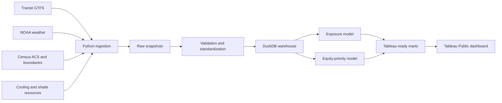

# Architecture

## Data flow

## Data layers

### Raw

Immutable source snapshots with retrieval time, source URL, checksum, and source
version where available. Raw data is stored locally and is not committed to Git.

### Processed

Standardized tables with stable types, documented units, normalized identifiers,
and validated geographic coordinates.

### Analytics-ready

Dimensional tables designed for transparent analysis and Tableau performance:

- `dim_stop`
- `dim_route`
- `dim_date`
- `dim_time_period`
- `dim_census_tract`
- `fact_scheduled_stop_service`
- `fact_stop_weather_exposure`
- `fact_stop_resource_access`
- `mart_stop_heat_risk`

## Design principles

- Preserve source lineage from every dashboard measure back to raw data.
- Separate measured values from modeled estimates.
- Keep exposure and equity-priority scores distinct.
- Make every weighting choice configurable and documented.
- Publish data dates and limitations next to visual conclusions.

